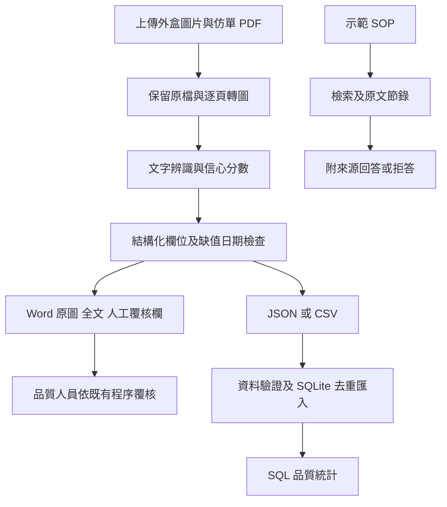

# 進口醫藥產品外盒與仿單辨識及審核報告輔助系統

本作品將醫藥產品文件人工覆核情境，轉化為可以實際操作的 Python 專案：上傳外盒圖片或仿單 PDF，系統辨識文字、整理品名／批號／效期，產出附原圖與人工覆核欄的 Word 報告，並提供資料匯入、品質統計及附來源的 SOP 查詢。

作品使用自行製作的虛構資料，展示品質管理經驗如何結合程式設計、資料處理與雲端部署。系統僅協助整理證據，**不自動決定產品放行，也不判定法規合規**。

## 先呈現這些成果

| 展示面向 | 已實作內容 | 實際驗證 |
| --- | --- | --- |
| 文件辨識 | 圖片與多頁 PDF 文字辨識，擷取品名、批號、效期、序號及全文 | 英文合成圖片與兩頁 PDF 測試通過 |
| 審核報告 | Word 包含原圖、辨識結果、缺值提示、人工覆核及簽名欄 | 可透過操作頁產生並下載 |
| 資料處理 | JSON／CSV 匯入 SQLite，資料格式驗證、重送去重與 SQL 統計 | 雲端驗收新增 1 筆、重複 1 筆 |
| 知識查詢 | 搜尋示範 SOP，引用檔名、章節及原文；查無足夠證據就拒答 | 來源引用與拒答測試通過 |
| 容器環境 | Docker 封裝 Python、OCR、PDF 工具及繁體中文語言包 | Mac 與 GCP 的 Linux 容器均成功啟動 |
| 雲端部署 | 部署於 GCP 虛擬機，透過 SSH 隧道操作 | GCP 容器內 23 項測試全部通過 |
| 持續整合 | GitHub Actions 自動建置、測試、依賴掃描與軟體物料清單 | [首輪雲端流程成功](https://github.com/amy71023a-eng/Pharma_OCR-/actions/runs/39557254909) |

知識查詢採用「檢索後節錄原文」的輕量方法，不需要模型金鑰；**尚未串接生成式大型語言模型**。此處不將它宣稱為完整的生成式 RAG 系統。

## 系統解決什麼問題

人工核對進口產品外盒與仿單時，需要在原圖、批號、效期及文件內容之間反覆切換，也需要整理紀錄。本作品把資料整理與報告產出串成同一條流程，讓覆核者保留原始證據，專注判讀差異。

1. 保留原檔：上傳文件保存到獨立工作資料夾，PDF 逐頁轉成圖片。
2. 辨識與整理：文字辨識後，以明確標籤規則整理品名、批號與效期；缺值保留空值，不猜測補填。
3. 提示覆核：缺值、日期格式異常及低信心結果會提示人工確認。
4. 產出紀錄：將擷取結果、逐頁原圖、全文及人工覆核欄合併為 Word。
5. 資料再利用：將 JSON／CSV 匯入資料庫，檢查重複與缺漏，產生統計。

## 架構概覽



## 在自己的電腦啟動

先安裝並啟動 Docker Desktop，再下載或複製此儲存庫。在專案根目錄執行：

```bash
git clone https://github.com/amy71023a-eng/Pharma_OCR-.git
cd Pharma_OCR-
docker compose up -d --build --wait
```

開啟 http://127.0.0.1:8081 。這個指令會建置環境、啟動服務並等待健康檢查；主機不必另外安裝 Python、Tesseract 或 Poppler。第一次建置需要下載套件。

若已下載 ZIP，只需解壓、進入 `pharma-review` 資料夾，執行最後一行指令。預設服務只供本機連線，產生的資料保留在 Docker 資料卷中。

## 展示順序

1. 上傳文件：在操作頁選擇 `examples/sample.pdf`，按「辨識並產生 Word」。此檔包含虛構外盒與仿單共兩頁。
2. 展示報告：下載 Word，對照品名、批號、效期、原圖及完整文字。說明人工覆核欄保留空白，系統不代替品質單位決策。
3. 展示資料管線：執行下方匯入指令兩次，觀察重送資料如何去重。
4. 展示知識查詢：詢問「OCR 信心低於85怎麼處理」，查看 SOP 來源；再問「明天天氣與股市預測」，確認系統拒答。
5. 展示工程驗證：開啟測試紀錄及 GitHub Actions，說明相同程式在本機及 GCP 都可執行。

## 資料管線與統計

```bash
docker compose exec -T review python etl.py examples/records.json --db output/demo.sqlite
docker compose exec -T review python etl.py examples/records.csv --db output/demo.sqlite
```

這兩個指令在容器內執行「擷取資料 → 驗證與轉換 → 載入資料庫」，也就是 ETL。示範 JSON 含兩筆相同文件；乾淨資料庫首次預期新增 1 筆、重複 1 筆。再次匯入相同內容時，不會重複新增。

去重依據是原始全文的 SHA256 雜湊。相同批號但文字不同仍會保留，以免差異版本被誤刪；目前沒有自動判定哪一版才是核准資料。

```sql
-- 檢查總筆數及缺少效期的筆數
SELECT COUNT(*) AS total, SUM(expiry IS NULL) AS missing_expiry FROM batches;

-- 統計每個產品的文件數
SELECT product, COUNT(*) AS documents FROM batches GROUP BY product;

-- 找出同批號有多份文件的線索，供人工調查
SELECT batch, COUNT(*) FROM batches GROUP BY batch HAVING COUNT(*) > 1;
```

## 測試與操作維護

```bash
# 執行單元、介面及真實 OCR 整合測試
docker compose exec -T review python -m pytest -v

# 驗證執行中的服務、Word 下載、知識查詢及圖片 PDF 辨識
docker compose exec -T review python scripts/container_check.py

# 查看容器狀態與最近日誌
docker compose ps
docker compose logs --tail=100

# 將容器產生的報告與資料下載到電腦
docker compose cp review:/app/output/. ./downloaded-output/

# 停止服務，保留資料卷
docker compose down
```

測試涵蓋欄位解析、閏年與日期、缺值、重複資料、OCR 失敗、Word 原圖、CSV、介面回應、SOP 來源與拒答。外部 OCR 工具缺少時，整合測試會標示略過；本次 GCP 的 23 項測試均通過，沒有略過。

GitHub Actions 也會執行套件漏洞掃描及產生 CycloneDX 格式的軟體物料清單（SBOM）。掃描沒有發現已知漏洞，不代表系統不存在其他風險。

## 雲端部署與連線

已在 GCP 的 Ubuntu 24.04、2 vCPU、8 GiB 記憶體、約 30 GB 磁碟之 VM 部署 Docker，並完成容器健康檢查、23 項測試與資料管線驗收。應用透過 SSH 隧道使用，未將應用連接埠對全網開放。

實際 VM 連線命令及部署證據見 [已完成的雲端部署說明](deploy/DEPLOYED.md)。新環境安裝步驟見 [Docker 與雲端部署指南](deploy/README.md)。OCI 依本次範圍保留可執行步驟，尚未實際部署。

## 技術選擇與意義

| 工具 | 在作品中的作用 |
| --- | --- |
| Python／FastAPI | 提供操作頁、文件處理 API、健康檢查及互動介面文件 |
| Pydantic／JSON Schema | 固定輸出欄位型別，讓 API、報告與資料管線共用契約 |
| Tesseract／Poppler | 將影像辨識為文字，並將 PDF 逐頁轉圖 |
| python-docx | 自動產生包含原圖與人工覆核欄的 Word |
| SQLite／SQL | 儲存結構化資料、重送去重及品質統計 |
| pytest | 把解析規則與異常情境轉成可重現測試 |
| Docker／GitHub Actions | 封裝執行環境，在本機及雲端自動建置與驗證 |

## 專案檔案導覽

| 檔案或資料夾 | 內容 |
| --- | --- |
| `app.py` | 操作頁、API、OCR、欄位解析及 Word 報告 |
| `rag.py`、`knowledge/` | SOP 檢索、附來源的原文節錄與拒答 |
| `etl.py`、`evaluate.py` | 資料匯入、SQL 統計及標註資料評估 |
| `examples/` | 虛構圖片、PDF、文字、JSON／CSV 與已知標籤 |
| `tests/` | 單元、介面與 OCR 整合測試 |
| `deploy/` | Docker 安裝、GCP VM 與雲端部署步驟 |
| `docs/TEST_PLAN.md` | 測試計畫及人工驗收、OCR 評估方法 |
| `.github/workflows/ci.yml` | GitHub 自動建置與驗證流程 |

本機執行結果在 `output/`；GitHub 驗證結果可從 Actions 的 `container-evidence` 下載。原始產出、日誌及資料庫不直接提交到儲存庫。

## 使用限制與人工覆核界線

- 欄位解析支援行首 `Product／品名`、`LOT／Batch／批號`、`EXP／Expiry／效期` 與 `SN／序號`，標籤後允許空白或冒號。自由版面或標籤不符時可能缺值，不自動猜測。
- 年月效期依示範規則換算月底，實務上仍須依既有 SOP 確認；不自動修補 OCR 的 O／0 混淆。
- 低信心結果會優先提示覆核；高信心也不能免除人工核對。信心分數不是校準後的正確率。
- 色塊、字體、印刷與版面僅提供人工比對提示，沒有自動色差或版面合格判定。
- 已實測英文合成文件；繁體中文語言包雖已封裝，尚未完成中文文件效能驗證。單一合成樣本不能代表真實文件準確率。
- 上傳限制為 10 MB、PDF 最多十頁；不保證手寫辨識，也不支援加密 PDF。
- 尚未實作生成式 LLM、登入權限、電子簽章、完整稽核軌跡、產品核准主檔或正式合規驗證。僅供虛構資料示範。

## 實拍小字辨識修正

新增月/年效期、原印效期與序號；辨識不足時，依標籤偵測做局部放大及銳化。各次 OCR 原文與來源保留，衝突候選不自動選定。照片驗收與界線見 `docs/OCR_PHOTO.md`；目前本機共 29 項測試通過。此修正尚未推送 GitHub 或部署 GCP。


## Gemini 生成式 RAG
已實作可選雲端整理、來源編號驗證及失敗回退原文；預設為本機檢索。設定與測試限制請見 [Gemini 操作說明](docs/GEMINI_SETUP.md)。實際雲端呼叫須設定個人金鑰後驗證。
