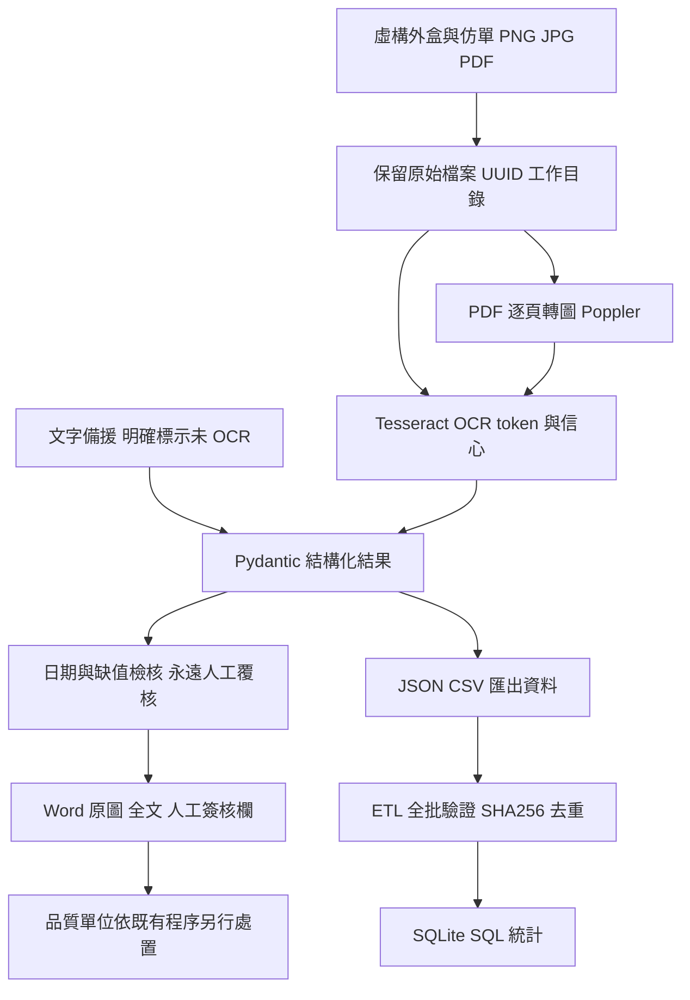

# 系統架構及設計取捨

FastAPI 提供操作頁、API、OpenAPI `/docs`、`/health`。Pydantic 統一 JSON Schema，這是確定性 structured output，不代表已導入 LLM。解析規則支援行首 Product/品名、LOT/Batch/批號、EXP/Expiry/效期加冒號；未符合標籤的自由版面會缺值，不推測補值。

MVP 把外盒及仿單合併為同一 PDF 逐頁處理，也可分別上傳圖片。原圖與全文都保留。多個相同標籤只取第一個，目前不做跨頁產品身分配對；實際批次上線前必須新增衝突偵測、外盒/仿單分組與主檔比對。

ETL 以全文 SHA256 作精確重送去重。同批號但不同文字仍會新增，避免誤刪差異版本；尚未定義產品及批號的業務唯一鍵。SQLite 僅供單機示範，正式流程需資料版本、權限、審核軌跡、備份及主檔規則。

已實作：OCR 呼叫與逐頁 PDF、全文、規則解析、欄位結構、Word、操作頁、CLI、ETL、pytest、Docker/CI 設定。
第二版新增：SOP 字詞檢索、附檔名章節與原文的擷取式回答、查無資料拒答；Docker 執行與容器內測試。
未實作：LLM、模型微調、GCP/OCI 部署、登入權限、核准樣本比對、色差量測、法規驗證與電子簽章。Docker build 已實際執行，GitHub 雲端 CI 尚未實際執行。
